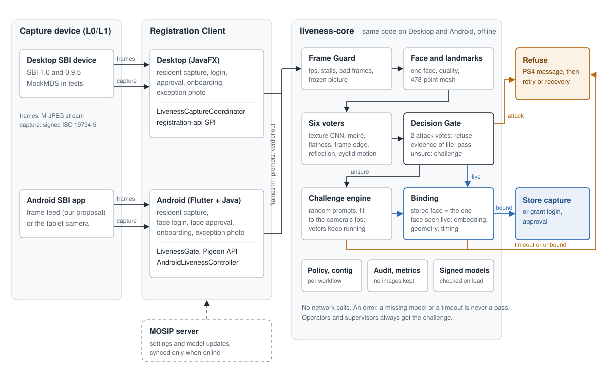

# SAJEEV (सजीव)

*Seen live, then stored.* Face liveness and presentation-attack detection (PAD) for the MOSIP Desktop and Android Registration Clients (MOSIP Decode 2026, problem statement 4).

A face is stored only if the person was judged live **and** the captured face is the face that was seen live.



| For the submission | Where |
|---|---|
| Summary (1–2 pages) | [docs/SUBMISSION.md](docs/SUBMISSION.md) |
| Architecture, user flows, wireframes, screens | [docs/design/](docs/design/README.md), [docs/ARCHITECTURE.md](docs/ARCHITECTURE.md), [docs/UIUX/](docs/UIUX/README.md) |
| API documentation | [docs/API.md](docs/API.md) |
| Test data (no accounts or credentials needed) | [docs/TEST_DATA.md](docs/TEST_DATA.md) |
| Test cases and results | [docs/TEST_CASES.md](docs/TEST_CASES.md), [docs/TEST_RESULTS.md](docs/TEST_RESULTS.md) |
| Installation and usage | below, and [docs/INSTALL.md](docs/INSTALL.md) for the client patches |
| Every document | [docs/TD_INDEX.md](docs/TD_INDEX.md) |

## What exists (28 Oct 2026)
- **Engine** (`liveness-core`, Java 11, also runs on Android): six voters (texture CNN, moiré, flatness, frame edge, reflection, eyelid motion), a deterministic Decision Gate that counts only voters with positive evidence of life (texture, flatness, eyelid motion) towards a passive pass, ten randomised challenges with re-evaluation (all voters keep running during a challenge), Binding (one face, embedding, geometry, timing), policy, audit, metrics. The safety laws are tested as properties and by mutation (`BUILD_LOG.md` #31). Settings follow the client's configuration, per workflow (resident, operator, supervisor).
- **Devices** (`devices`): SBI 1.0 and 0.9.5 adapters tested against MOSIP's mock devices; Android frame-feed, capture-only (labelled LIMITED) and CameraX sources.
- **Desktop client** (patches `0001`, `0005`; fork branch `sajeev/release-1.2.0.x`): resident capture, operator and supervisor face checks, configuration, English/French/Arabic texts, audit. Built and unit-tested with JDK 11. **Never run on a screen.**
- **Android client** (patches `0006`, `0007`; fork branch `sajeev/liveness`; `integrations/engine-android`): the engine as an AAR, Pigeon bridge, Flutter liveness widget, resident capture gate, **face login and face approval for operators and supervisors** (off by default), configuration, six languages, audit. The engine runs on an Android emulator and the debug APK builds. **Never run against a MOSIP server.**
- **Mock devices** (patches `0002`–`0004`): a frame feed for MOSIP's mock Android camera app and a replay mode with a chosen frame rate for MockMDS. Both say `mock: true`.
- **Bench** (`bench/run.sh`), **evaluation harness** (`eval/`: APCER/BPCER with Wilson intervals, baselines, sealed held-out run), **interoperability harness** (`interop/`).

## What does not exist yet (read this first)
- **Very little real data.** One person, one room, one webcam: 2 bona fide clips and 4 attack clips (a phone showing a photo, a phone playing a video, three times). No printed-photo attack has been recorded. The numbers in `BUILD_LOG.md` (28 Oct robustness matrix) show behaviour, not rates to quote. All thresholds are starting values, not tuned.
- **Known weakness, measured:** in the resident flow (HYBRID, as in the PS4 flow) a **video of the person played on a phone passed the passive gate in 6 of 24 presentations**: a video shows a real moving head and real eyelids, so the motion-based voters are fooled, and the texture CNN is not stable across frame rates and compression. Operators and supervisors always get the active challenge (`ACTIVE_ALWAYS`); setting `policy.mode.resident=ACTIVE_ALWAYS` closes the path for residents too. The challenge itself was passed by chance by about 2% to 5% of replays of a recording that does not see the prompt.
- No real phone, no Windows machine, no MOSIP server login: neither client was run end to end. The Android settings, the frame-rate behaviour and the screens were checked by unit tests, an emulator and compile.
- Hindi, Kannada and Tamil texts are **machine translations** written for this project and not reviewed by native speakers; French and Arabic are unreviewed drafts.
- The MiniFASNet weights have no stated licence; the MediaPipe model card terms are unchecked (`DISCLOSURES.md`). The signing key is a development key.
- Hardware acceleration was tried (CoreML, NNAPI) and is **disabled**: neither matched the CPU's scores. The low-resource timings are from a Mac and an emulator, not a phone.

## Install and use

**Needs:** JDK 17 and Maven 3.9 (the engine compiles for Java 11), `curl`, about 40 MB for the models. macOS or Linux; Windows was not tried. No account, key or server is needed.

1. **Get the code**
   ```
   git clone https://github.com/ArushJain-697/Sajeev.git && cd Sajeev
   ```
2. **Download the models** (signed, SHA-256 pinned, from the release `models-0.1.0`)
   ```
   scripts/fetch_models.sh
   export SAJEEV_MODELS=$PWD/liveness-models/models
   ```
3. **Build and run the tests** (276 tests; 5 skip unless MOSIP's MockMDS is running on port 4501)
   ```
   mvn -pl liveness-api,liveness-core,devices,bench,eval test -Dsajeev.models=$SAJEEV_MODELS
   ```
4. **Run the engine on a picture, a folder of frames or an M-JPEG stream.** It prints the verdict, the reason and the frame rate.
   ```
   bench/run.sh --clip testdata/fixtures-faces/one_face.jpg
   bench/run.sh --clip testdata/recorded-095/stream-face.mjpeg --workflow OPERATOR
   ```
   Both print `verdict: ATTACK_SUSPECTED error=PAD_FAIL reason=frozen_stream`: one picture fed as a stream, and MockMDS streaming its one stock image, are frames that never change, which no camera pointed at a person produces. That is the intended result. A recording of yourself goes through step 5.
5. **Evaluate your own recordings** (bona fide and attacks; how to record them: `eval/RECORDING_PROTOCOL.md`)
   ```
   eval/ingest.sh mysession s1 mycamera ~/clips
   eval/run_eval.sh --manifest eval/clips/mysession/manifest.csv --clips eval/clips/mysession --out metrics.json
   ```
   `metrics.json` lists every clip with its verdict and votes, plus APCER and BPCER with 95% Wilson intervals.
6. **Put it in a Registration Client.** Desktop: apply patches `0001` and `0005` to `registration-client` `release-1.2.0.x`, or use the fork branch `sajeev/release-1.2.0.x`. Android: build the engine AAR and apply `0006` and `0007`, or use the fork branch `sajeev/liveness`. Exact commands: [docs/INSTALL.md](docs/INSTALL.md); settings: [docs/CONFIG.md](docs/CONFIG.md).

Without the models the tests that need them skip, and say so. Per-ticket status, limits and numbers: `BUILD_LOG.md`. The four MOSIP forks and how they are built from the patches: `integrations/README.md`.

Licence: MPL-2.0 (`LICENSE`), third-party list in `DISCLOSURES.md`.
