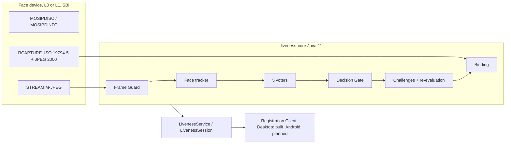

# Architecture

State of the code on 23 Oct 2026. What is built is stated plainly; Android items are marked.

## Overview {#overview}

Modules: `liveness-api` (frozen interfaces), `liveness-core` (engine), `devices` (SBI 1.0 and 0.9.5 adapters, mock file source), `desktop-ui` (JavaFX pane), `bench` (command-line runner), `interop` (contract checks), `eval` (metrics). Engine code compiles for Java 11 and has no network class.

## Streaming {#streaming}

The device streams M-JPEG over HTTP (`STREAM`, ports 4501-4600). The adapter parses frames (`MjpegParser`), Frame Guard measures the real rate, and frames enter a bounded queue that drops the oldest when full, so the frame producer is never blocked. During `RCAPTURE` the SBI spec stops the stream; liveness therefore decides **before** the capture starts, and Binding checks the capture **after** it returns. Order change from today's client: the stream and capture no longer start together.

## Engine {#engine}

One `LivenessEngine` holds the models once (YuNet, landmark mesh, two MiniFASNets, SFace) and creates a session per attempt. Each session runs its pipeline on its own daemon thread. The gate and the safety rules are pure functions (`DecisionGate`, `SessionAcceptance`). Execution providers other than CPU are used only if an equivalence check is recorded (D35); on this Mac CoreML differed by 7e-3 and is disabled.

## Online and offline {#offline}

Nothing in the engine calls a network. Configuration is read from the client's local parameters (synced when online, last synced values when offline). Models are signed (ECDSA P-256, D43) and verified at load; updates only arrive through the online sync. Operator authentication matches against the operator's onboarded biometrics locally in both modes; liveness runs before the match in both.

## Desktop integration (built in a build copy of release-1.2.0.x, JDK 11)

`registration-api` gets a small SPI (`LivenessFacade`, session provider); `registration-services` gets the coordinator and the engine bridge; `GenericBiometricsController` runs liveness before `rCapture` and applies the gate before anything is stored; `BaseController.captureAndValidateFace` does the same for operator and supervisor. Delivered as patches `0001` and `0005`; not yet applied in a fork and not yet run on a screen.

## Android

Planned, not built: engine as an AAR with ONNX Runtime Android, a Pigeon bridge and a Flutter widget. The mock SBI frame feed (patch 0003) and the engine on the emulator are proven; the rest is open.
