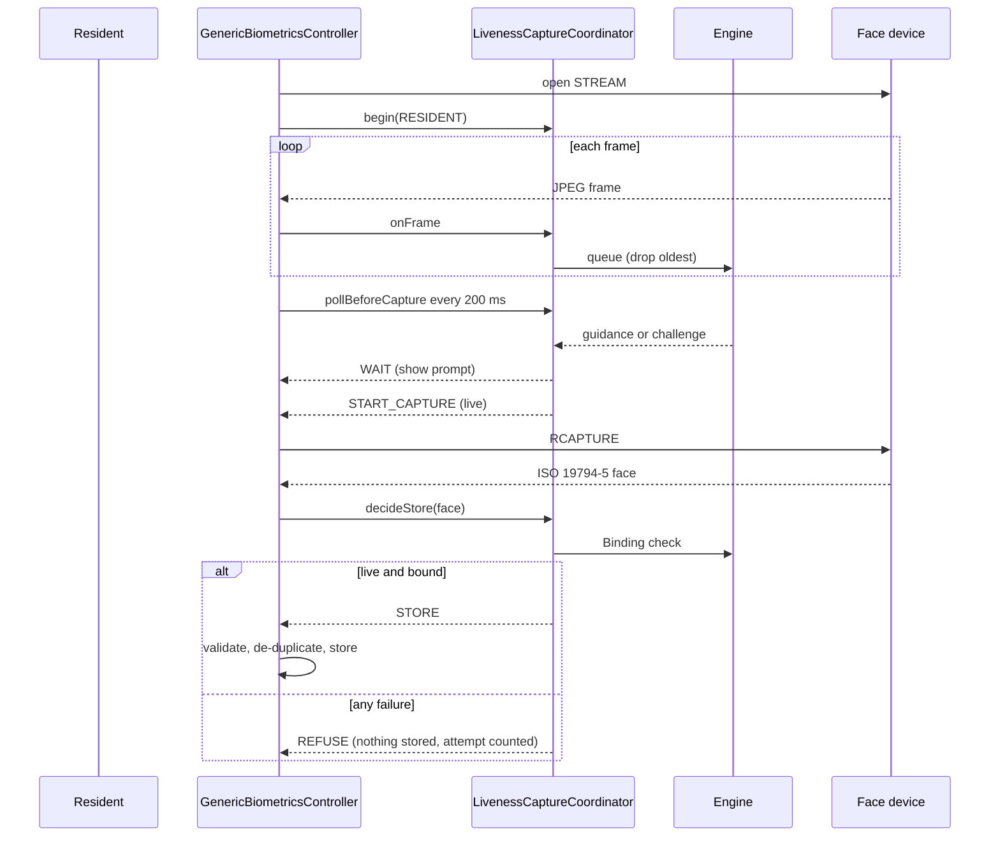
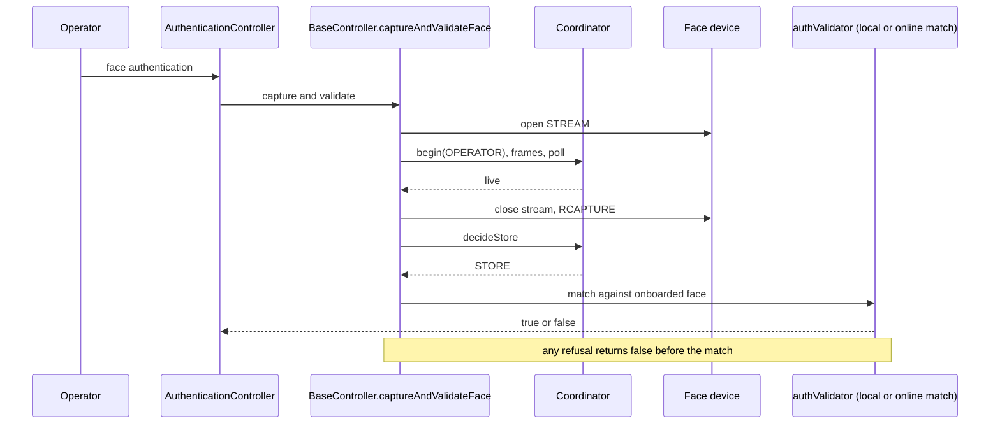

# Sequence diagrams

Desktop sequences match the code in patch 0005. Android sequences are the plan; those screens are not built.

## Resident {#resident} (desktop)

## Operator {#operator} (desktop)

## Supervisor {#supervisor} (desktop)

Same as operator with `begin(SUPERVISOR)`, used by the reviewer path of `AuthenticationController` and by `EODAuthenticationController`. The "supervisor physically present" wording: the check shows that a live person was in front of the camera; it does not prove who that person is, the existing face match does.

## Android (planned, not built)

Resident, operator and supervisor on Android follow the same three steps (liveness first, capture, Binding, then the existing step). The resident capture runs through an intent to the SBI app, so liveness must finish before the intent is fired and Binding runs when the result returns. Operator and supervisor face login are new screens (the clients are password-only today). No diagram is drawn for code that does not exist.
