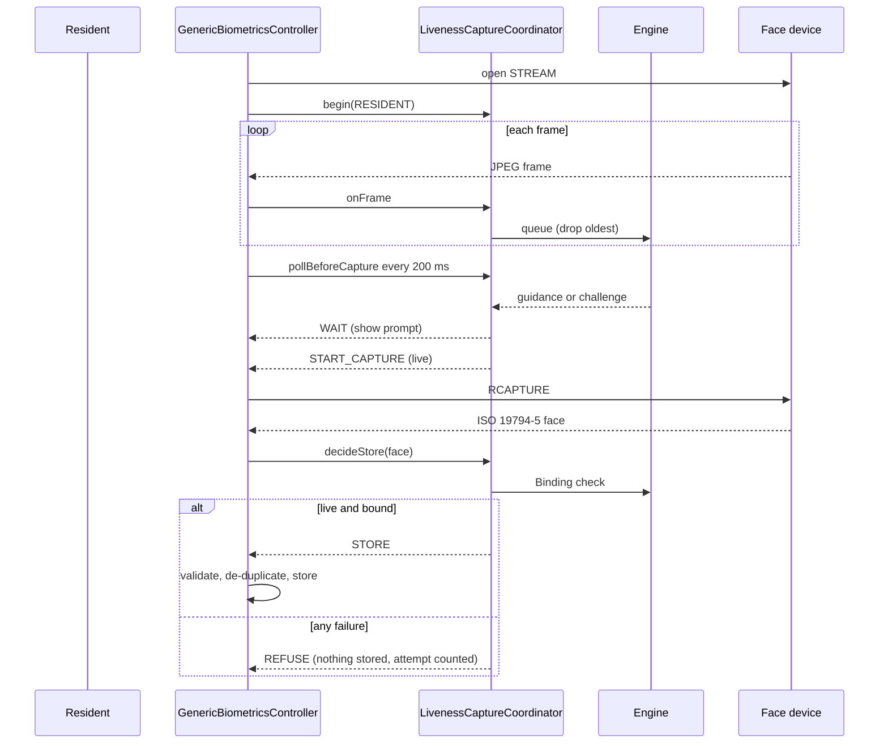
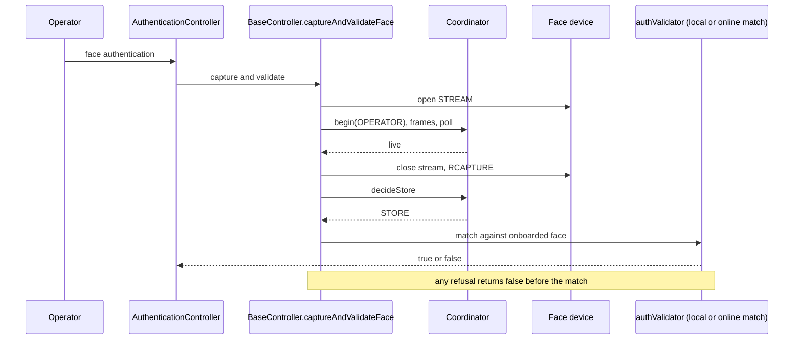
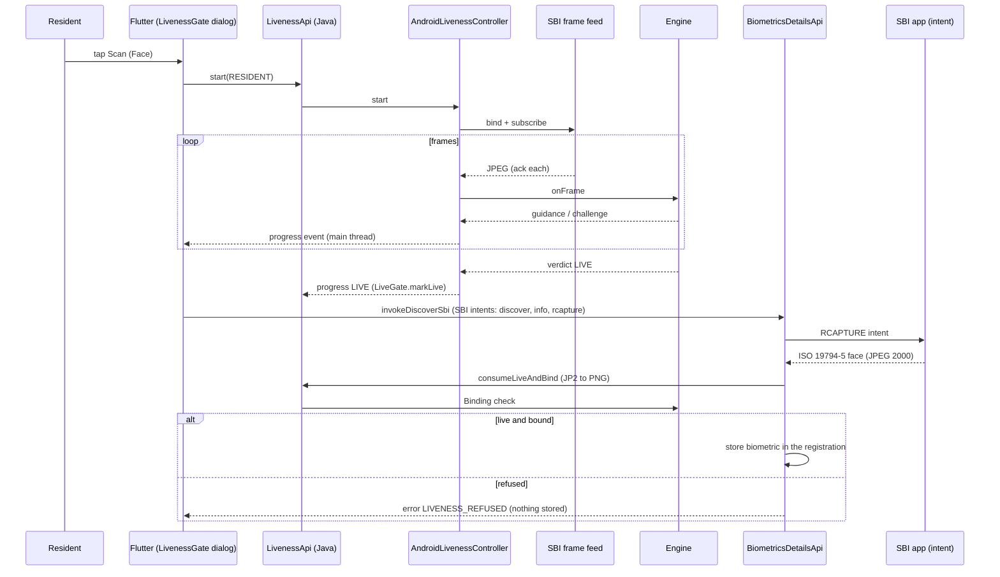
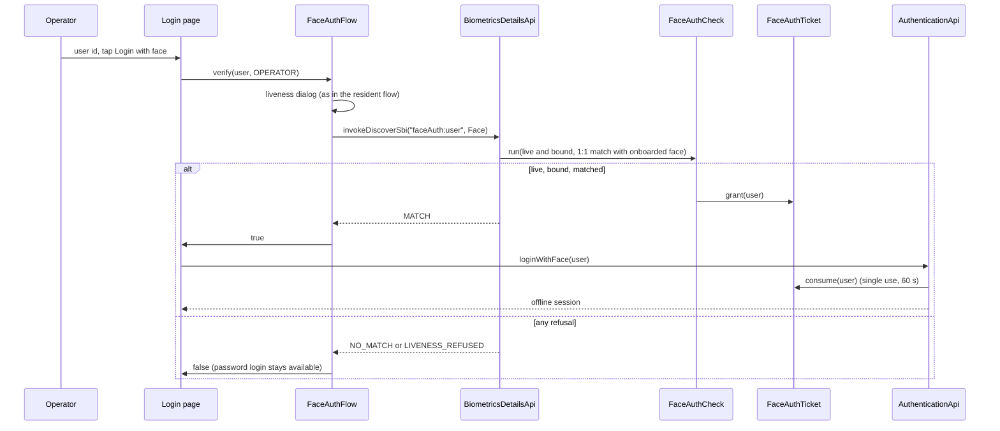

# Sequence diagrams

Desktop sequences match the code in patch 0005. Android sequences are the plan; those screens are not built.

## Resident {#resident} (desktop)

## Operator {#operator} (desktop)

## Supervisor {#supervisor} (desktop)

Same as operator with `begin(SUPERVISOR)`, used by the reviewer path of `AuthenticationController` and by `EODAuthenticationController`. The "supervisor physically present" wording: the check shows that a live person was in front of the camera; it does not prove who that person is, the existing face match does.

## Android resident {#android-resident}

Matches `LivenessGate`, `LivenessApi`, `AndroidLivenessController` and `BiometricsDetailsApi.parseRCaptureResponse` (patch 0006). Not run on a screen.

## Android operator login by face {#android-operator}

Matches `FaceAuthFlow`, `BiometricsDetailsApi.parseFaceAuthResponse`, `FaceAuthCheck`, `FaceAuthTicket` and `AuthenticationApi.loginWithFace`. Offline session only; needs `faceAuth.enabled = true`.

## Android supervisor approval {#android-supervisor}

Same as the operator login with `verify(user, SUPERVISOR)` from the approval dialog, and `PacketAuthenticationApi.authenticateWithFace(user)` spending the ticket instead of `loginWithFace`. The same dialog is used for the operator's post-registration authentication when the password is left empty (workflow OPERATOR).
