# Design: architecture, user flows, wireframes and screens

What a person sees, in what order, and what the system does underneath. The specification of all 15 PS4 UI/UX items is in [../UIUX/README.md](../UIUX/README.md); the screens below are rendered from the real Desktop pane (JavaFX) and the real Flutter widget, not drawn by hand.

## Architecture
How a frame travels from the capture device to a stored face or a refusal, on both clients, offline.

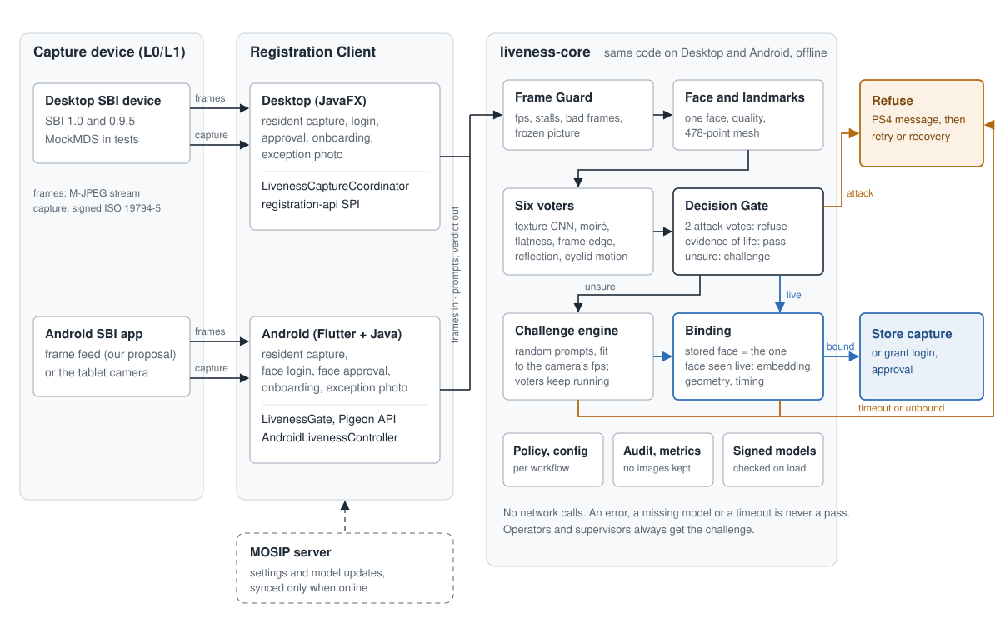

The engine is one library used unchanged by the Desktop client (Java 11) and the Android client (as an AAR). Blue is the only path to storing a face: through the Decision Gate or the challenge, then Binding. Amber is every way to a refusal. The MOSIP server only syncs settings and models when online. Text version with Mermaid diagrams: [../ARCHITECTURE.md](../ARCHITECTURE.md), sequences per workflow and platform: [../SEQUENCES.md](../SEQUENCES.md).

## User flows

**Resident face capture.** Passive first; a random challenge only when the passive check finds no evidence of life; the photo is stored only if it is the face seen live; retries until the limit, then the recovery process.

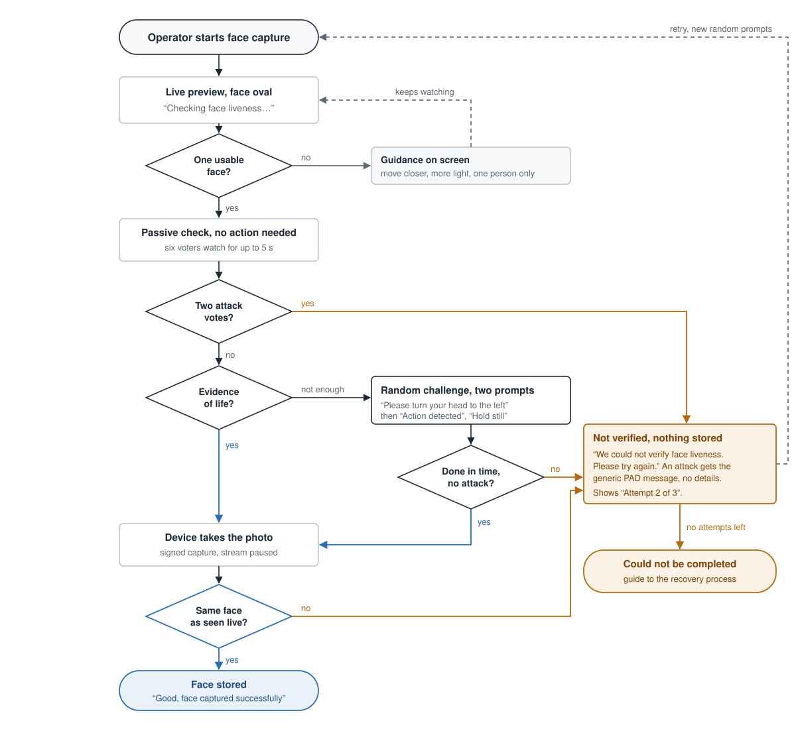

**Operator and supervisor authentication** (Desktop and Android). Liveness always runs first with three prompts, then Binding, then MOSIP's existing face match against the onboarded face.

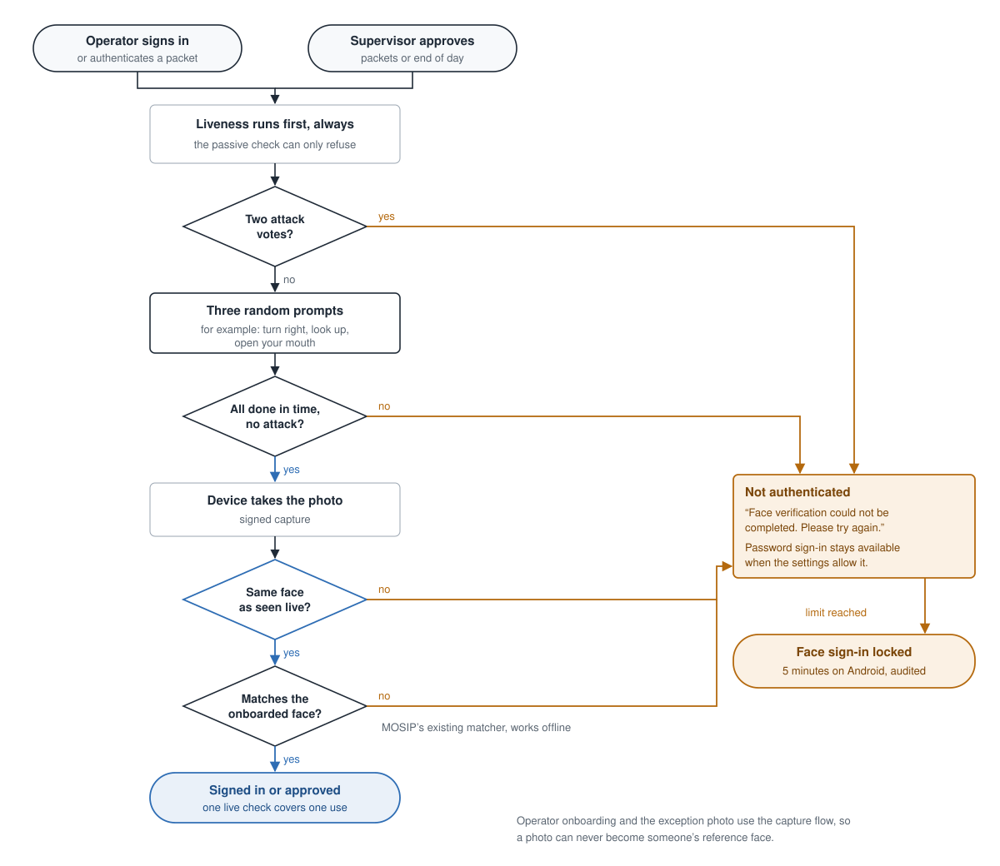

## Wireframes
The anatomy of the liveness pane and its four states, with the PS4 wording.

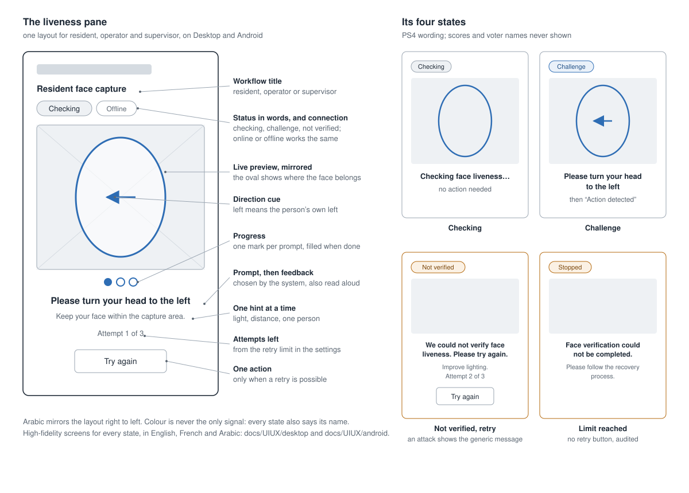

## High-fidelity screens

| | Desktop (JavaFX) | Android (Flutter) |
|---|---|---|
| Checking | 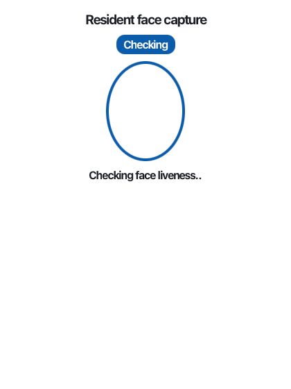 | 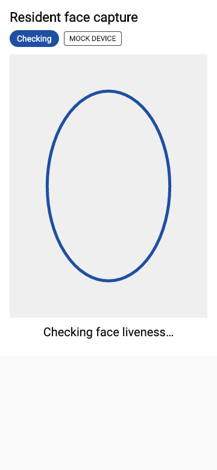 |
| Challenge | 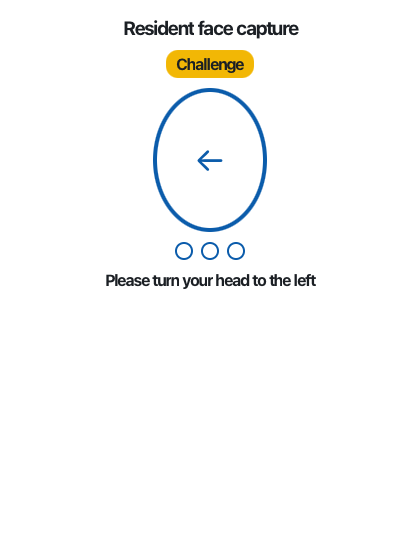 | 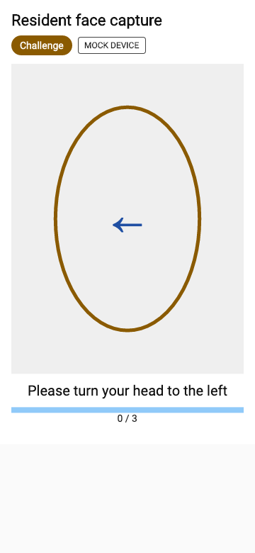 |
| Not verified, retry | 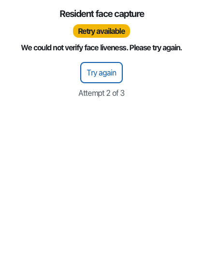 | 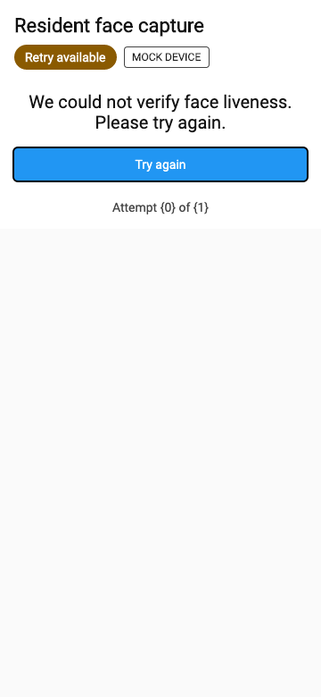 |
| Limit reached | 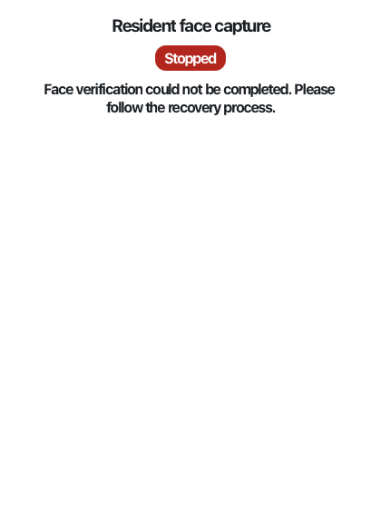 | 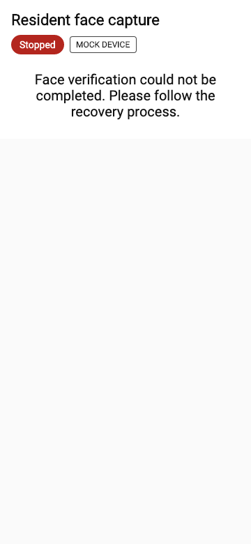 |
| Arabic, right to left | 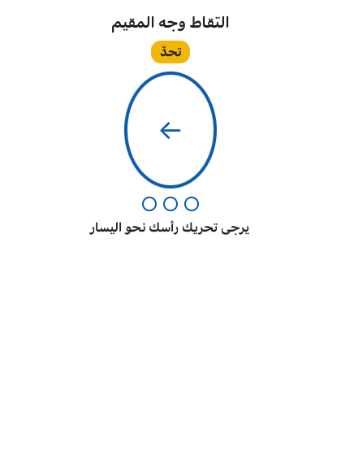 | 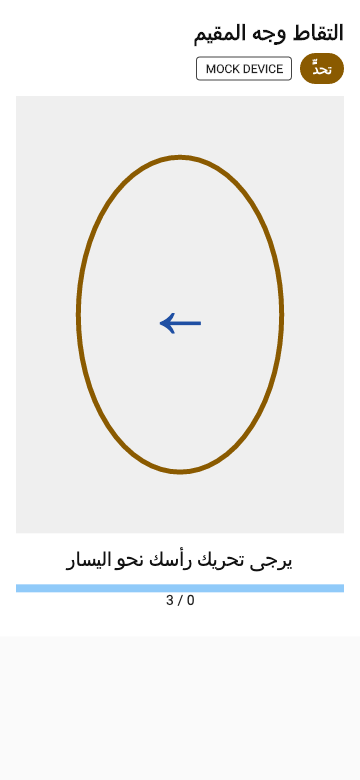 |

Every state in English, French and Arabic: [../UIUX/desktop/](../UIUX/desktop/) (44 screens) and [../UIUX/android/](../UIUX/android/) (19 screens). Clickable HTML mockups of all 15 items, with right-to-left and large-text toggles: [../UIUX/mockups.html](../UIUX/mockups.html).

## Design decisions
- **The system chooses the prompt** (PS4): there is no button to pick a test.
- **Words carry the state**, colour only repeats it: every badge says Checking, Challenge, Not verified or Stopped.
- **An attack gets the generic message** (“Face verification could not be completed”); details go only to audit and to the operator's diagnostic panel when an administrator turns it on.
- **Left means the person's own left** on the mirrored preview, and the arrow points that way.
- **One hint at a time**, the one that fixes the newest problem (light, distance, one person).
- **The same pane** for resident, operator and supervisor, and the same states and texts on Desktop and Android (one source of texts in six languages).

Not done: testing with real users and with screen-reader users.
